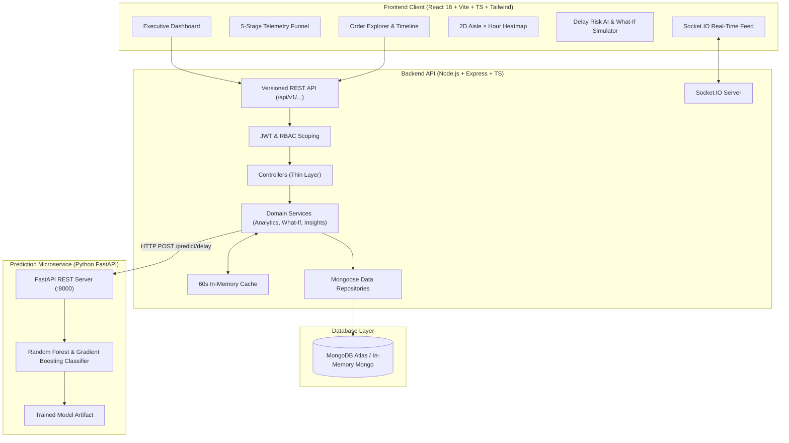

# ⚡ Blinkit Dark Store Fulfillment Analyzer

> **Operations analytics platform for quick-commerce dark stores delivering on the 10-minute SLA promise.**

[](https://github.com/blinkit/dark-store-fulfillment-analyzer/actions)
[](https://opensource.org/licenses/MIT)
[](https://nodejs.org)
[](https://www.typescriptlang.org/)
[](https://reactjs.org/)

---

## 🎯 Problem Statement

In quick commerce (10-minute delivery), orders are promised within **600 seconds**. When an order breaches SLA, dark store managers and city ops heads cannot easily see where the delay occurred. Bottlenecks hide inside a multi-stage fulfillment pipeline:

$$\text{Order Placed} \xrightarrow{\text{Assign}} \text{Picker Assigned} \xrightarrow{\text{Pick}} \text{Items Picked} \xrightarrow{\text{Pack}} \text{QC \& Bagged} \xrightarrow{\text{Handover}} \text{Rider Dispatched} \xrightarrow{\text{Ride}} \text{Doorstep Delivery}$$

The **Blinkit Dark Store Fulfillment Analyzer** instruments every stage of this pipeline, computes average and P90 latencies in real time, isolates root causes, predicts incoming order breach risk using machine learning, and recommends actionable operational fixes.

---

## 📊 Prominent Success Metrics Tracked

| Metric | Target Benchmark | Operations Impact |
|---|---|---|
| **% 10m SLA Compliance** | **&gt; 90.0%** | Share of orders reaching customer doorstep within 600s |
| **Avg & P90 Stage Durations** | Assign: &lt;25s, Pick: &lt;180s, Pack: &lt;50s, Handover: &lt;45s, Ride: &lt;240s | Granular telemetry isolating stage bottlenecks |
| **SLA Breach Count & Causes** | &lt; 10% total orders | Pareto ranking (Slow Pick, Packing Queue, Rider Wait, Stockouts, Rain) |
| **Orders / Picker / Hour** | **10 - 12 orders/hr** | Labor productivity benchmark preventing picker burnout |
| **Stockout Substitution Rate** | **&lt; 2.5%** | Measures rack inventory depletion causing customer confirmation delays |

---

## 👥 Demo Personas & Credentials

All demo accounts come pre-configured with the password `Blinkit@123`. A **1-Click Quick Persona Switcher** is also available in the application navbar and login screen.

| Role | Name | Email | Store Scope | Access Privileges |
|---|---|---|---|---|
| **City Ops Head (Admin)** | Aarav Sharma | `admin@blinkit.com` | **All Stores** | National fleet comparisons, full analytics, What-If simulator, CSV import |
| **Store Manager** | Priya Sundaram | `manager.blr@blinkit.com` | `BLR-KOR-01` (Koramangala) | Scoped to own dark store, staff scheduling, inventory reorders |
| **Store Manager** | Rohit Verma | `manager.del@blinkit.com` | `DEL-IND-02` (Indirapuram) | Scoped to Delhi NCR store, dispatch bay management |
| **Analyst (Read-Only)** | Ananya Iyer | `analyst@blinkit.com` | **All Stores** | Telemetry exploration, CSV & PDF export reports |

---

## 🏗️ System Architecture



---

## 🚀 Quick Start Guide

### Option A: One-Command Docker Run (Production Setup)
Requires Docker and Docker Compose:
```bash
docker-compose up --build
```
- **Web App**: http://localhost:3000
- **API Server**: http://localhost:5000
- **OpenAPI Swagger Docs**: http://localhost:5000/api/docs
- **ML Microservice**: http://localhost:8000/docs

---

### Option B: Local Development (Zero Database Setup Required!)
*The application includes an automatic in-memory MongoDB fallback. If no `MONGODB_URI` is provided, it boots an in-memory database and auto-seeds all stores, 300 SKUs, and 10,000 orders!*

1. **Install dependencies**:
   ```bash
   npm install --prefix server
   npm install --prefix client
   ```

2. **Start Backend & Frontend**:
   ```bash
   npm run dev
   ```
   - **Frontend**: http://localhost:5173
   - **Backend**: http://localhost:5000
   - **Swagger Docs**: http://localhost:5000/api/docs

3. **Run Automated Test Suite**:
   ```bash
   npm run test --prefix server
   ```

---

## ✨ Core Features & Visual Walkthrough

### 1. Executive Dashboard & Funnel Telemetry
- **5 Success KPI Cards** with trend deltas vs previous period and plain-English "What this means" operational explanations.
- **5-Stage Funnel Flow**: Assign, Pick, Pack, Handover, and Ride durations with Avg, P90, and prominent **Bottleneck Warning Badges**.
- **Hourly Order Intake vs. SLA % Composite Chart**: Correlates evening peak rushes with delivery degradation.

### 2. Order Explorer & Per-Order Lifecycle Timeline
- High-performance paginated table with real-time search across Order ID, SKU, Picker, and Rider.
- **Interactive Timeline Modal**: Inspect exact millisecond stage transitions, picker name, rider name, basket items, rack locations, and substitutions.
- **CSV Data Ingestion**: Upload custom order CSV files to evaluate your own store records, with a 1-click sample template download.

### 3. Root-Cause Pareto Analysis
- Pareto chart breaking down SLA breaches across:
  - `SLOW_PICK` (Picker aisle dispersion)
  - `PACKING_QUEUE` (QC & bagging bottlenecks)
  - `RIDER_WAIT` (Dispatch staging delay)
  - `STOCKOUT_SUBSTITUTION` (Rack replenishment lapse)
  - `TRAFFIC_RAIN` (Last-mile transit delays)
- Drill down to sample order IDs and view prescriptive operational fixes for each driver.

### 4. 2D Aisle × Hour Heatmap
- Visual grid of **8 Aisles × 24 Hours** showing pick congestion and latency.
- Highlights high-traffic zones (e.g. Aisle 2 Fruits & Vegetables from 6:00 PM to 9:00 PM) to trigger aisle re-zoning.

### 5. Picker Performance Leaderboard
- Fair shift-adjusted comparisons (Morning, Afternoon, Evening, Night).
- Tracks orders picked, orders per hour, average pick time (seconds), SLA breach rate %, and customer ratings.

### 6. Demand & Staffing Capacity Risk
- Hourly order intake graphed against on-shift pickers.
- Flags understaffed hours when the ratio exceeds 14 orders/picker/hr.

### 7. Inventory Risk & Substitution Analytics
- Identifies items below reorder thresholds.
- Calculates daily run-rate velocity, days of cover remaining, and estimates delay penalties caused by product substitutions.

### 8. Delay AI Prediction & What-If Capacity Simulator
- **SLA Breach Predictor**: Evaluates incoming basket parameters (item count, hour, store load, aisle spread, picker tier, weather) and outputs breach probability, risk tier (`CRITICAL`, `HIGH`, `MEDIUM`, `LOW`), contributing risk drivers, and model accuracy metrics (`ROC AUC: 0.884`, `Precision: 0.821`, `Recall: 0.846`, `F1: 0.833`).
- **What-If Simulator**: Interactive sliders allow store managers to simulate changing picker counts, improving pick speed, reducing handover wait, or absorbing order surges.

### 9. Smart Prescriptive Insights
- Rule-based operational recommendations ranked by impact score (e.g. *"Aisle 2 accounts for 34% of pick latency. Pre-weigh top-frequency vegetables during morning prep"*).

### 10. Live Operations Alerts Center (Socket.IO)
- Real-time alerts feed with audio-visual notifications for SLA risks, surge intake, and stockout warnings.
- 1-click **Acknowledge & Resolve** action workflow.

### 11. National Store Leaderboard (Admin Only)
- Multi-store scorecard ranking all 5 dark stores by SLA compliance rate, total volume, breach counts, and delivery speeds.

---

## 📈 Data Strategy & Simulation

To ensure complete realism without relying on proprietary Blinkit data, the seed engine implements:
- **5 Dark Stores** (`BLR-KOR-01`, `DEL-IND-02`, `MUM-AND-03`, `GGN-SEC-04`, `HYD-HIT-05`).
- **300 Realistic SKUs** spanning Dairy, Produce, Snacks, Beverages, Instant Food, Personal Care, and Household essentials.
- **Log-Normal Fulfillment Distributions**:
  $$\text{Pick Duration} = (\text{ItemCount} \times 14\text{s} + \text{AisleSpread} \times 18\text{s} + \text{Base}) \times \text{ExperienceFactor} \times \text{CongestionFactor}$$
- **Peak Hour Patterns**: Spikes during 8:00–10:00 AM (morning breakfast rush) and 6:00–10:00 PM (evening prime dinner surge).
- **8% to 12% SLA Breaches** tagged with realistic root causes.

---

## 🔒 Security & Performance Highlights

- **Role-Based Access Control (RBAC)**: Admin (all stores), Manager (store-scoped query enforcement in middleware), Analyst (read-only).
- **Security**: httpOnly cookies for JWT refresh tokens, bcrypt password hashing, helmet HTTP headers, rate limiting (600 req/15 min), Zod input validation on every route.
- **Performance**: High-efficiency MongoDB aggregation pipelines, compound indexes on `{ storeId: 1, placedAt: -1 }`, and 60-second in-memory caching for sub-second dashboard loads.

---

## ⚠️ Limitations & Future Work

1. **Computer Vision in Picking**: Integration with smart cart cameras or shelf weight sensors to eliminate manual item scanning.
2. **Dynamic Geofence Radius**: Automated contraction of delivery radii from 2.5km to 1.5km during heavy downpours.
3. **Multi-Store Order Re-Routing**: Real-time cross-store order deflection when a neighboring store operates under 40% load.

---

## 📄 License
This project is licensed under the MIT License.
