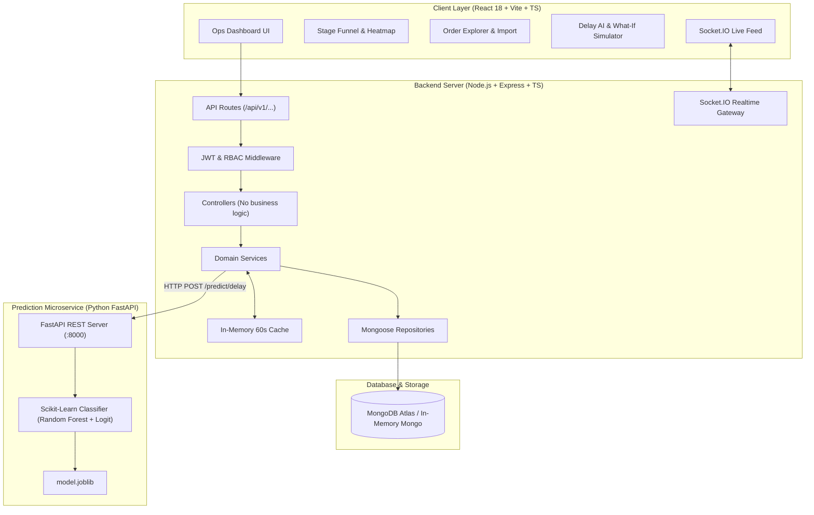
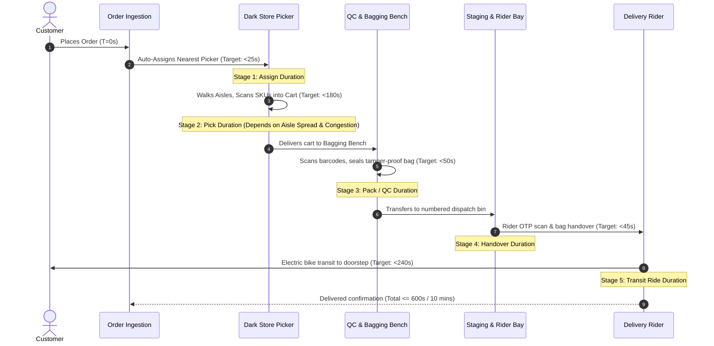

# Blinkit Dark Store Fulfillment Analyzer - System Architecture

## 1. High-Level Architecture Overview

The platform uses a modular decoupled architecture designed for high throughput quick-commerce telemetry (10-minute delivery SLA).

---

## 2. 10-Minute Order Telemetry Lifecycle Pipeline

In quick-commerce fulfillment, every second is instrumented across 5 distinct milestones:

---

## 3. Data Flow & Aggregation Pipelines

- **No Heavy In-Browser Stats**: All percentile calculations (P90), breach breakdowns, hourly demand profiles, and aisle heatmaps are computed in MongoDB Aggregation Pipelines on indexed fields:
  - `{ storeId: 1, placedAt: -1 }`
  - `{ storeId: 1, isBreached: 1, placedAt: -1 }`
  - `{ placedAt: -1, isBreached: 1 }`
- **60-Second TTL In-Memory Cache**: Heavy aggregate endpoints (`/analytics/overview`, `/analytics/stage-breakdown`, `/analytics/root-causes`) cache responses for 60 seconds.
- **Fail-Safe Delay Prediction**:
  1. Node backend attempts to call Python FastAPI microservice at `:8000/predict/delay`.
  2. If Python service is offline, backend seamlessly falls back to an embedded calibrated logistic engine with identical feature weights and returns SLA probability, risk tier, and model metrics.
